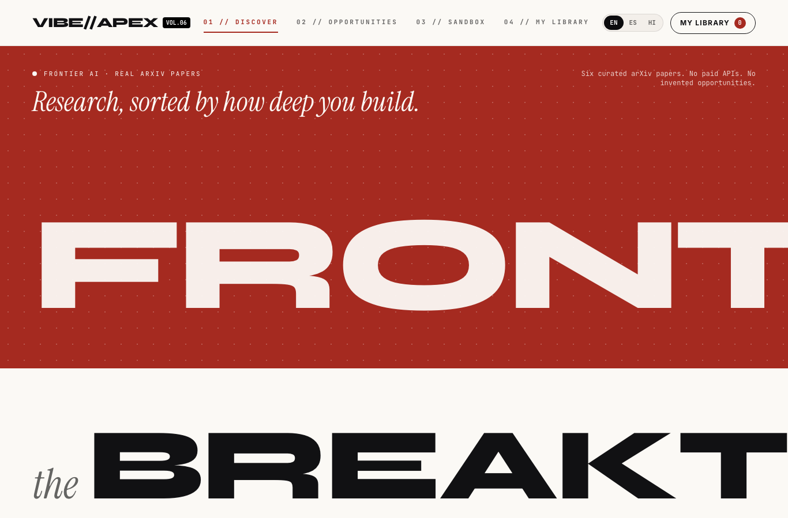
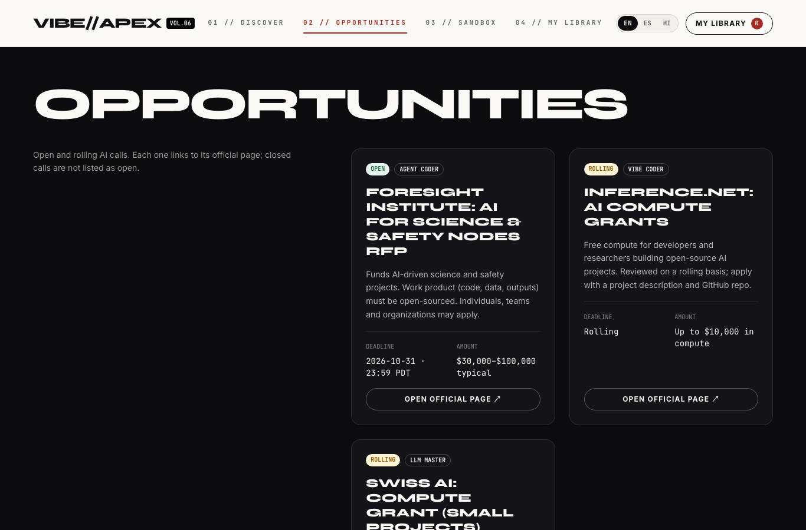
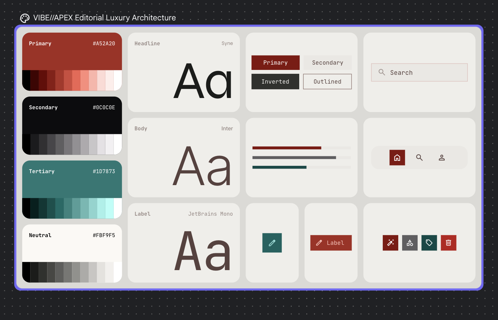

# VIBE//APEX

A static, editorial-style hub for AI enthusiasts, from first-time vibe coders to LLM researchers. It shows real arXiv papers sorted by skill level, verified open AI opportunities, setup commands for each tier, and a personal library.

Repository: https://github.com/walruto/VIBE-APEX





## Features

- **Four tabs:** 01 Discover (papers), 02 Opportunities (open AI calls), 03 Sandbox (setup commands), 04 My Library (saved papers).
- **Three languages:** English, Spanish and Hindi, switched with the toggle in the header. UI text, paper summaries and paper titles translate; author names and original abstracts stay in English.
- **Skill tiers:** every paper and opportunity is tagged Vibe Coder, Agent Coder or LLM Master.
- **Persona filter** on the Discover tab.
- **Saved library** kept in the browser's local storage. Nothing is sent to a server.

## Guardrails

- No paid APIs. The site is static HTML, CSS and JavaScript with no backend and no API keys.
- No invented opportunities. Every listed opportunity links to its official page, and closed calls are not shown as open.
- Real papers only. Every arXiv ID and date was checked against arxiv.org.

## Design system

The look comes from the VIBE//APEX Editorial Luxury Architecture board, which was produced in Google Stitch. The board is in [`docs/design-guidelines.png`](docs/design-guidelines.png).



| Token | Value | Used for |
|---|---|---|
| Primary | `#A52A20` | Primary buttons, accents, hero background |
| Secondary | `#0C0C0E` | Obsidian text and dark blocks |
| Tertiary | `#1D7873` | Sandbox actions |
| Neutral | `#FBF9F5` | Cream page background |
| Headline | Syne | Section titles and card headings |
| Body | Inter | Summaries and metadata text |
| Label | JetBrains Mono | Tags, status badges, and buttons |

Button variants (from the board): Primary, Secondary, Inverted and Outlined, implemented as `.btn-primary`, `.btn-secondary`, `.btn-inverted` and `.btn-outlined` in `index.html`. The hero uses `.btn-hero` for the featured-paper button on the red background.

The tokens are defined as CSS variables in `:root` at the top of the `<style>` block in `index.html`.

<details>
<summary>Stitch prompt used for the design (verbatim)</summary>

```markdown
I like what you did so far # Role & Persona
You are a Principal Product Designer and Lead UI/UX Engineer specialized in building highly modular, performant micro-frontends using the Google Stitch layout and component engine. You excel at taking bold, contemporary, editorial lifestyle print layouts and translating them into robust, responsive code structures, reusable slots, and precise data schemas.
# Project Context: VIBE//APEX
We are architecting the complete multi-tab layout for "VIBE//APEX"—a cutting-edge dashboard ecosystem designed for AI enthusiasts spanning three explicit technical tiers:
1. **Vibe Coder:** Beginners focusing on prompt-driven development, rapid no-code logic, and natural language app deployment.
2. **Agent Coder:** Intermediate builders handling multi-agent orchestration platforms, local runtime scripting, and API routing.
3. **LLM Master:** Advanced engineers building fine-tuning pipelines, token optimization matrixes, and low-level attention mechanisms.
# Core Guardrails & System Rules
- **No Real Physical Events:** All entries must capture virtual ecosystem milestones (e.g., repository releases, benchmark evaluations, token grant windows, weight drops).
- **Factual Grounding:** All research paper objects referenced in mock data structures must be real, high-impact AI papers.
- **Multilingual Localization UI:** The design must feature a unified language toggle component (`stitch-language-toggle`) handling English (EN), Spanish (ES), and Hindi (HI). The layout must use fluid scaling tokens to prevent textual text-expansion breaking across different locales.
- **Visual Design Continuity:** Every tab must retain the inspiration aesthetic: massive structural typography section breaks, deep color-blocked backdrops (terracotta, dark slate, obsidian), sharp minimalist borders, asymmetrical card distributions, and zero generic enterprise data tables.
# Task Breakdown & Stitch Components to Generate
## 1. Global Layout Frame & Router (`stitch-navigation-hub`)
- Design a high-impact global navigation bar defining the strict typography, alignment, and hover states for four core tabs: `DISCOVER`, `THE LABS`, `SANDBOX`, and `MY LIBRARY`.
- Integrate the high-contrast `stitch-language-toggle` as an outlined segmented pill button in the top right header space.
## 2. Tab 1 Component Model: `DISCOVER` (`stitch-paper-action-grid`)
- Formulate an asymmetrical grid rendering real AI research papers into custom visual cards.
- Each paper element must map explicit properties (`props`): `paper_title`, `date_published`, `opening_status` (e.g., "Weights Available", "Benchmark Live"), `time_stamp`, `important_info` (1-sentence architectural impact), and `target_level` (Vibe Coder, Agent Coder, or LLM Master).
## 3. Tab 2 Component Model: `THE LABS` (`stitch-lab-showroom`)
- Design a high-contrast container mapping active global AI compute tokens, residency applications, or benchmark submissions hosted by elite labs (e.g., Anthropic, DeepMind).
- Style this view like a premium brand showroom, using vertical text alignments and luxury-tier metadata blocks.
## 4. Tab 3 Component Model: `SANDBOX` (`stitch-sandbox-provisioner`)
- Design a layout handling environment templates tailored to the papers. Ensure distinct rows or groupings for each skill tier, utilizing minimalist frames mimicking premium product specifications.
## 5. Tab 4 Component Model: `MY LIBRARY` (`stitch-user-ledger`)
- Design a personal tracking portfolio modeled like a raw, stark data invoice/ledger tracking saved papers and user progression milestones.
# Output Format
Present your entire response as a highly detailed Stitch Technical Design Specification. For each tab component, provide:
1. **Component Architecture & APIs:** The Google Stitch custom tag syntax, expected input configuration schemas, and slot architectures.
2. **Visual Hierarchy Specs:** Layout styles, positioning mechanics (absolute overlay vs flex-asymmetric), typography weights, and color tokens.
3. **Multilingual Mock Data Suite:** Provide a comprehensive JSON or code array mapping three distinct real-world paper entries across all three languages (EN, ES, HI) to prove the localization engine's data-handling integrity.
```

</details>

## Run it locally

```bash
git clone https://github.com/walruto/VIBE-APEX.git
cd VIBE-APEX
python3 -m http.server 8080
```

Then open http://localhost:8080/index.html. Opening `index.html` directly also works.

The page loads Tailwind CSS and Google Fonts from their CDNs, so it needs an internet connection the first time.

## Project structure

```
index.html   The whole site: page layout, Tailwind config, styles, the four tab
             sections, the papers/opportunities/sandbox/strings data, and the
             rendering script
docs/        Screenshots and the code-change log used in this README
```

The site is one self-contained HTML file. All content is in the inline data block at the top of the script, near the start of the `<script>` tag before the rendering code. To add a paper or opportunity, add an entry there. Opportunities need an official source URL and a checked deadline or "rolling" status.

## How it was built

### Prompt log

Every prompt that shaped this project, in order, with what it produced. The prompts are shown in improved form, and some typos are kept on purpose. The original typed text is in this README's git history (commit `05b5207`).

**Part A: prompts from the design chat (before the repo existed).** These went to a search-based AI assistant, and the transcript was pasted into the first message of the coding session.

| # | Prompt (improved) | What it did | Code generated |
|---|---|---|---|
| A1 | Use this image as inspo to start building the UI/UX for a platform that lets people find AI opportunities and discover AI research papers. | Asked for the inspiration image, which was not attached, then described a UI direction in general terms. | None (text reply) |
| A2 | Design a platform for AI enthusiasts of every lvl, from beginner to advanced. Include a dashboard where people can browse research papers. Guardrail: no real-world events, only real AI papers. For each entry show the date, status of opening, time and important info, plus a level tag: Vibe Coder, Agent Coder or LLM Master. Name the platform too. | Named the platform "VIBE & APEX", wrote a Stitch meta-prompt, and built a mock feed of three paper cards with date, status, time and level. | None (text reply) |
| A3 | Add a language toggle for English and Spanish, and Hindi as well. | Renamed the platform to "VIBE//APEX" and described localized strings. No toggle code was produced. | None (text reply) |
| A4 | The Stitch design is great, but it only has the home page. Build the rest of the tabs for this project and keep the UI and design the same throughgout. | Designed four tabs (DISCOVER, THE LABS, SANDBOX, MY LIBRARY) with EN/ES/HI copy and a locale token JSON. | None (text reply) |
| A5 | Now generate the other pages in the same Stitch design, with the same tabs, theme and multilingual data. | Produced a Stitch technical design spec for all four tabs, plus a three-paper multilingual data set. | None (spec text) |
| A6 | Now integrate the design made in Google Stitch using Claude. Rules: no paid APIs, no fake opportunities, real arXiv papers only. | Produced a single HTML file with Tailwind, the four tabs and a language dictionary. The output was cut off mid-file, and it contained invented grants and prices. | Full single-file HTML, in the transcript only (cut off mid-file; not in the repo) |

**Part B: prompts in the coding session (the requests that changed this repo).**

Each prompt below shows the exact lines it generated, taken from git. Prompts that changed no code say so.

#### B1

> Here is the Stitch export (`/Users/walidahmed/Downloads/stitch_editorial_ai_ecosystem_discovery_platform.zip`) and the design-chat transcript (Part A). Unzip it, review the design, and build a working site from it.

**What it did:** Unzipped the Stitch export, reviewed both screens, checked the arXiv IDs, and built the first version in `vibe-apex/`.

**Commit:** [`c516907`](https://github.com/walruto/VIBE-APEX/commit/c516907)

````diff
diff --git a/app.js b/app.js
new file mode 100644
index 0000000..2d537ca
--- /dev/null
+++ b/app.js
@@ -0,0 +1,351 @@
+(function () {
+  const LANG_KEY = "vibe-apex-lang";
+  const LIBRARY_KEY = "vibe-apex-library";
+  const TABS = ["discover", "labs", "sandbox", "library"];
+
+  let lang = readStorage(LANG_KEY, "en");
+  let filter = "all";
+  let library = readStorage(LIBRARY_KEY, []);
+  let openId = null;
+  let toastTimer = null;
+
+  const byId = (id) => document.getElementById(id);
+  const esc = (s) => String(s).replace(/[&<>"']/g, (c) => ({ "&": "&amp;", "<": "&lt;", ">": "&gt;", '"': "&quot;", "'": "&#39;" }[c]));
+
+  function readStorage(key, fallback) {
+    try {
+      const v = localStorage.getItem(key);
+      return v === null ? fallback : JSON.parse(v);
+    } catch (e) {
+      return fallback;
+    }
+  }
+
+  function writeStorage(key, value) {
+    try {
+      localStorage.setItem(key, JSON.stringify(value));
+    } catch (e) {
+      /* storage unavailable (private window); the page still works without it */
+    }
+  }
+
+  function t(key) {
+    return (UI[lang] && UI[lang][key]) || UI.en[key] || key;
+  }
+
+  function levelLabel(level) {
+    return t("lvl_" + level);
+  }
+
+  function statusLabel(status) {
+    const map = {
+      code_released: { en: "Code Released", es: "Código publicado", hi: "कोड जारी" },
+      weights_available: { en: "Weights Available", es: "Pesos disponibles", hi: "वेट्स उपलब्ध" },
+      preprint_open: { en: "Preprint Open", es: "Preprint abierto", hi: "प्रीप्रिंट खुला" }
+    };
+    return map[status][lang] || map[status].en;
+  }
+
+  function paperById(id) {
+    return PAPERS.find((p) => p.id === id);
+  }
+
+  function summaryOf(p) {
+    return p.summary[lang] || p.summary.en;
+  }
+
+  function badges(p) {
+    return `
+      <span class="text-[10px] font-mono font-bold uppercase px-2 py-0.5 rounded-full ${STATUS_STYLES[p.status]}">${esc(statusLabel(p.status))}</span>
+      <span class="text-[10px] font-mono font-bold uppercase px-2 py-0.5 rounded-full border ${LEVEL_STYLES[p.level]}">${esc(levelLabel(p.level))}</span>`;
+  }
+
+  // ---------- Spotlight (hero) ----------
+  function renderSpotlight() {
+    const p = paperById("deepseek");
+    const html = `
+      <article class="bg-white rounded-3xl p-6 shadow-2xl text-[#111113]">
+        <div class="flex items-center justify-between text-[10px] font-mono uppercase tracking-widest">
+          <span class="text-terracotta">● ${esc(t("spotlight_label"))}</span>
+          <span class="bg-paper-cream px-2 py-1 rounded">arXiv:${esc(p.arxiv)}</span>
+        </div>
+        <h2 class="font-display font-black text-2xl leading-tight mt-5">${esc(p.title)}</h2>
+        <p class="text-sm text-black/60 mt-4 leading-relaxed">${esc(summaryOf(p))}</p>
+        <div class="flex items-center justify-between mt-5 text-xs">
... (794 more lines; full diff at the commit link and in docs/CODE-CHANGES.md)
````

#### B2

> Run the site.

**What it did:** Started a local server on port 8080.

**Code generated:** none. This prompt did not change the code.

#### B3

> Push this to GitHub. Do not credit yourself; credit only https://github.com/walruto/VIBE-APEX.

**What it did:** Pushed the site to the empty repo, with a commit message that credits only the repo URL.

**Code generated:** same commit as B1 (see above).

#### B4

> When I change the language, the actual opportunity text doesn't change. Fix that.

**What it did:** Made the Labs list entries show the translated summary.

**Commit:** [`81b25bc`](https://github.com/walruto/VIBE-APEX/commit/81b25bc)

````diff
diff --git a/app.js b/app.js
index 2d537ca..0704a1e 100644
--- a/app.js
+++ b/app.js
@@ -117,6 +117,7 @@
         <div>
           <p class="font-display font-bold uppercase text-sm">${esc(p.authors)}</p>
           <p class="text-xs text-cream/60 mt-1">${esc(p.title)}</p>
+          <p class="text-sm text-cream/80 mt-2 leading-relaxed">${esc(summaryOf(p))}</p>
         </div>
         <a href="https://arxiv.org/abs/${esc(p.arxiv)}" target="_blank" rel="noopener" class="text-xs font-mono font-bold uppercase text-terracotta-light underline shrink-0">arXiv:${esc(p.arxiv)} ↗</a>
       </li>`).join("");
````

#### B5

> Rerun the site.

**What it did:** Restarted the local server.

**Code generated:** none. This prompt did not change the code.

#### B6

> The text of the opportunities still doesn't change with the language.

**What it did:** Reproduced the issue in headless Chrome and found the Labs text did translate. Asked which text was meant.

**Code generated:** none. This prompt did not change the code.

#### B7

> You forgot the AI opprotunities tab: I only see AI papers. Also the paper titles aren't translated into the selected language. Fix both issues.

**What it did:** Replaced the empty Labs area with three verified open calls from official pages, renamed the tab to OPPORTUNITIES, and translated the six paper titles with the English original shown beneath.

**Commit:** [`c4af4e4`](https://github.com/walruto/VIBE-APEX/commit/c4af4e4)

````diff
diff --git a/app.js b/app.js
index 0704a1e..bf7c2f9 100644
--- a/app.js
+++ b/app.js
@@ -41,7 +41,9 @@
     const map = {
       code_released: { en: "Code Released", es: "Código publicado", hi: "कोड जारी" },
       weights_available: { en: "Weights Available", es: "Pesos disponibles", hi: "वेट्स उपलब्ध" },
-      preprint_open: { en: "Preprint Open", es: "Preprint abierto", hi: "प्रीप्रिंट खुला" }
+      preprint_open: { en: "Preprint Open", es: "Preprint abierto", hi: "प्रीप्रिंट खुला" },
+      open: { en: "Open", es: "Abierta", hi: "खुला" },
+      rolling: { en: "Rolling", es: "Continua", hi: "रोलिंग" }
     };
     return map[status][lang] || map[status].en;
   }
@@ -50,8 +52,21 @@
     return PAPERS.find((p) => p.id === id);
   }
 
-  function summaryOf(p) {
-    return p.summary[lang] || p.summary.en;
+  function summaryOf(item) {
+    return item.summary[lang] || item.summary.en;
+  }
+
+  // Translated title when one exists; the English original is shown beneath it.
+  function titleOf(p) {
+    return (p.titles && p.titles[lang]) || p.title;
+  }
+
+  function titleBlock(p, cls) {
+    const translated = titleOf(p);
+    const original = translated !== p.title
+      ? `<span class="block text-[11px] font-mono font-normal normal-case tracking-normal text-black/50 mt-2">${esc(p.title)}</span>`
+      : "";
+    return `<span class="${cls}">${esc(translated)}${original}</span>`;
   }
 
   function badges(p) {
@@ -69,7 +84,7 @@
           <span class="text-terracotta">● ${esc(t("spotlight_label"))}</span>
           <span class="bg-paper-cream px-2 py-1 rounded">arXiv:${esc(p.arxiv)}</span>
         </div>
-        <h2 class="font-display font-black text-2xl leading-tight mt-5">${esc(p.title)}</h2>
+        <h2 class="font-display font-black text-2xl leading-tight mt-5">${esc(titleOf(p))}</h2>
         <p class="text-sm text-black/60 mt-4 leading-relaxed">${esc(summaryOf(p))}</p>
         <div class="flex items-center justify-between mt-5 text-xs">
           <span class="font-mono text-black/50">${esc(p.date)}</span>
@@ -84,14 +99,14 @@
     byId("spotlightMobile").innerHTML = html;
   }
 
-  // ---------- Grid ----------
+  // ---------- Discover grid ----------
   function renderGrid() {
     const visible = PAPERS.filter((p) => filter === "all" || p.level === filter);
     byId("paperGrid").innerHTML = visible.map((p) => `
       <article class="bg-white border border-black/10 rounded-2xl p-6 flex flex-col gap-4 hover:border-black/30 transition">
         <div class="flex flex-wrap gap-2">${badges(p)}</div>
         <p class="text-[11px] font-mono text-black/50">arXiv:${esc(p.arxiv)} · ${esc(p.date)}</p>
-        <h3 class="font-display font-black text-xl leading-tight uppercase">${esc(p.title)}</h3>
+        <h3 class="font-display font-black text-xl leading-tight uppercase">${titleBlock(p, "")}</h3>
         <p class="text-sm text-black/60 leading-relaxed">${esc(summaryOf(p))}</p>
         <div class="mt-auto pt-4 border-t border-black/10 flex items-center justify-between">
           <button class="open-btn text-xs font-mono font-bold uppercase text-terracotta hover:underline cursor-pointer" data-id="${p.id}">${esc(t("inspect"))} ↗</button>
@@ -110,14 +125,36 @@
     });
   }
 
-  // ---------- Labs ----------
+  // ---------- Opportunities (Labs tab) ----------
+  function renderOpportunities() {
+    byId("oppGrid").innerHTML = OPPORTUNITIES.map((o) => {
+      const isOpen = o.status === "open";
+      const when = isOpen
+        ? `<div><dt class="text-[10px] uppercase text-cream/50">${esc(t("opp_deadline"))}</dt><dd class="mt-1">${esc(o.deadline)} · ${esc(o.time)}</dd></div>`
+        : `<div><dt class="text-[10px] uppercase text-cream/50">${esc(t("opp_deadline"))}</dt><dd class="mt-1">${esc(t("opp_rolling"))}</dd></div>`;
+      return `
+      <article class="rounded-2xl bg-[#141418] border border-white/10 p-6 flex flex-col gap-4">
+        <div class="flex flex-wrap gap-2">
... (298 more lines; full diff at the commit link and in docs/CODE-CHANGES.md)
````

#### B8

> Change the DOSSIER button to My Library, and adjust it for all languages as well.

**What it did:** Changed the header button to My Library, Mi biblioteca and मेरी लाइब्रेरी.

**Commit:** [`efba354`](https://github.com/walruto/VIBE-APEX/commit/efba354)

````diff
diff --git a/data.js b/data.js
index 5f90ebe..7fccb33 100644
--- a/data.js
+++ b/data.js
@@ -222,7 +222,7 @@ window.UI = {
     nav_labs: "02 // OPPORTUNITIES",
     nav_sandbox: "03 // SANDBOX",
     nav_library: "04 // MY LIBRARY",
-    dossier: "Dossier",
+    dossier: "My Library",
     hero_kicker: "Frontier AI · Real arXiv papers",
     hero_title: "FRONTIER",
     hero_tagline: "Research, sorted by how deep you build.",
@@ -276,7 +276,7 @@ window.UI = {
     nav_labs: "02 // OPORTUNIDADES",
     nav_sandbox: "03 // SANDBOX",
     nav_library: "04 // MI BIBLIOTECA",
-    dossier: "Dosier",
+    dossier: "Mi biblioteca",
     hero_kicker: "IA de frontera · Artículos reales de arXiv",
     hero_title: "FRONTERA",
     hero_tagline: "Investigación, ordenada según qué tan profundo construyas.",
@@ -330,7 +330,7 @@ window.UI = {
     nav_labs: "02 // अवसर",
     nav_sandbox: "03 // सैंडबॉक्स",
     nav_library: "04 // मेरी लाइब्रेरी",
-    dossier: "डोज़ियर",
+    dossier: "मेरी लाइब्रेरी",
     hero_kicker: "फ्रंटियर AI · वास्तविक arXiv शोधपत्र",
     hero_title: "फ्रंटियर",
     hero_tagline: "शोध, आपके निर्माण के स्तर के अनुसार छँटा हुआ।",
````

#### B9

> I like the idea of the spotlight paper, but it blocks the homepage a bit. Put it in a better spot, or remove it entirely.

**What it did:** Moved the spotlight card out of the hero into its own row, and removed a shadow strip on the closed drawer.

**Commit:** [`d525904`](https://github.com/walruto/VIBE-APEX/commit/d525904)

````diff
diff --git a/app.js b/app.js
index bf7c2f9..b72e100 100644
--- a/app.js
+++ b/app.js
@@ -79,7 +79,7 @@
   function renderSpotlight() {
     const p = paperById("deepseek");
     const html = `
-      <article class="bg-white rounded-3xl p-6 shadow-2xl text-[#111113]">
+      <article class="w-full max-w-sm bg-white rounded-3xl p-6 shadow-2xl text-[#111113]">
         <div class="flex items-center justify-between text-[10px] font-mono uppercase tracking-widest">
           <span class="text-terracotta">● ${esc(t("spotlight_label"))}</span>
           <span class="bg-paper-cream px-2 py-1 rounded">arXiv:${esc(p.arxiv)}</span>
@@ -96,7 +96,6 @@
         </div>
       </article>`;
     byId("spotlight").innerHTML = html;
-    byId("spotlightMobile").innerHTML = html;
   }
 
   // ---------- Discover grid ----------
diff --git a/index.html b/index.html
index a21cb79..ad2c2ae 100644
--- a/index.html
+++ b/index.html
@@ -32,7 +32,7 @@
     .bg-grid-dots { background-image: radial-gradient(rgba(255,255,255,.22) 1.5px, transparent 1.5px); background-size: 28px 28px; }
     .tab-pane { display: none; }
     .tab-pane.is-active { display: block; }
-    .drawer-open { transform: translateX(0); }
+    .drawer-open { transform: translateX(0); box-shadow: -20px 0 60px rgba(0, 0, 0, 0.25); }
     .drawer-closed { transform: translateX(100%); box-shadow: none; }
     .toast-show { opacity: 1; transform: translateY(0); }
     .toast-hide { opacity: 0; transform: translateY(20px); }
@@ -91,10 +91,9 @@
           </div>
           <h1 class="font-display font-black text-[22vw] md:text-[17vw] leading-none tracking-tighter whitespace-nowrap text-cream/95 select-none" data-i18n="hero_title"></h1>
         </div>
-        <!-- Floating spotlight card, filled by app.js -->
-        <div id="spotlight" class="absolute right-4 lg:right-14 top-1/2 -translate-y-1/2 w-[min(92vw,380px)] hidden lg:block"></div>
       </div>
-      <div id="spotlightMobile" class="lg:hidden px-4 -mt-10 relative z-10"></div>
+      <!-- Spotlight card sits in its own row below the hero, filled by app.js -->
+      <div id="spotlight" class="px-4 lg:px-14 py-16 flex justify-center lg:justify-end"></div>
 
       <!-- Divider -->
       <div class="px-4 lg:px-14 py-20 overflow-hidden">
@@ -171,7 +170,7 @@
 
   <!-- DOSSIER DRAWER -->
   <div id="modalBackdrop" class="fixed inset-0 bg-black/50 backdrop-blur-sm opacity-0 pointer-events-none transition-opacity z-50"></div>
-  <aside id="drawer" class="fixed top-0 right-0 h-full w-full max-w-lg bg-cream shadow-2xl overflow-y-auto z-50 drawer-closed transition-transform duration-300">
+  <aside id="drawer" class="fixed top-0 right-0 h-full w-full max-w-lg bg-cream overflow-y-auto z-50 drawer-closed transition-transform duration-300">
     <div class="p-8">
       <div class="flex items-center justify-between">
         <span id="drawerLevel" class="text-[10px] font-mono font-bold uppercase px-2.5 py-1 rounded-full border"></span>
````

#### B10

> Remove the spotlight paper entirely.

**What it did:** Removed the spotlight card and its code.

**Commit:** [`424e3ac`](https://github.com/walruto/VIBE-APEX/commit/424e3ac)

````diff
diff --git a/app.js b/app.js
index b72e100..3580178 100644
--- a/app.js
+++ b/app.js
@@ -75,29 +75,6 @@
       <span class="text-[10px] font-mono font-bold uppercase px-2 py-0.5 rounded-full border ${LEVEL_STYLES[p.level]}">${esc(levelLabel(p.level))}</span>`;
   }
 
-  // ---------- Spotlight (hero) ----------
-  function renderSpotlight() {
-    const p = paperById("deepseek");
-    const html = `
-      <article class="w-full max-w-sm bg-white rounded-3xl p-6 shadow-2xl text-[#111113]">
-        <div class="flex items-center justify-between text-[10px] font-mono uppercase tracking-widest">
-          <span class="text-terracotta">● ${esc(t("spotlight_label"))}</span>
-          <span class="bg-paper-cream px-2 py-1 rounded">arXiv:${esc(p.arxiv)}</span>
-        </div>
-        <h2 class="font-display font-black text-2xl leading-tight mt-5">${esc(titleOf(p))}</h2>
-        <p class="text-sm text-black/60 mt-4 leading-relaxed">${esc(summaryOf(p))}</p>
-        <div class="flex items-center justify-between mt-5 text-xs">
-          <span class="font-mono text-black/50">${esc(p.date)}</span>
-          <span class="text-[10px] font-mono font-bold uppercase px-2 py-0.5 rounded-full border ${LEVEL_STYLES[p.level]}">${esc(levelLabel(p.level))}</span>
-        </div>
-        <div class="flex gap-2 mt-6">
-          <button class="open-btn flex-1 py-3 rounded-full bg-obsidian text-white text-xs font-bold tracking-widest uppercase cursor-pointer" data-id="${p.id}">${esc(t("inspect"))} →</button>
-          <button class="save-btn w-12 rounded-full border border-black/20 cursor-pointer" data-id="${p.id}" aria-label="${esc(t("save"))}">${isSaved(p.id) ? "★" : "☆"}</button>
-        </div>
-      </article>`;
-    byId("spotlight").innerHTML = html;
-  }
-
   // ---------- Discover grid ----------
   function renderGrid() {
     const visible = PAPERS.filter((p) => filter === "all" || p.level === filter);
@@ -324,7 +301,6 @@
   }
 
   function refreshAll() {
-    renderSpotlight();
     renderFilters();
     renderGrid();
     renderOpportunities();
diff --git a/index.html b/index.html
index ad2c2ae..299d0e8 100644
--- a/index.html
+++ b/index.html
@@ -92,8 +92,6 @@
           <h1 class="font-display font-black text-[22vw] md:text-[17vw] leading-none tracking-tighter whitespace-nowrap text-cream/95 select-none" data-i18n="hero_title"></h1>
         </div>
       </div>
-      <!-- Spotlight card sits in its own row below the hero, filled by app.js -->
-      <div id="spotlight" class="px-4 lg:px-14 py-16 flex justify-center lg:justify-end"></div>
 
       <!-- Divider -->
       <div class="px-4 lg:px-14 py-20 overflow-hidden">
````

#### B11

> On the Opportunities tab there is a glitch: the word OPPORTUNITIES sits above the opportunities themselves. Fix that issue.

**What it did:** Moved the heading into its own full-width row above the cards and sized it to fit.

**Commit:** [`bee45e8`](https://github.com/walruto/VIBE-APEX/commit/bee45e8)

````diff
diff --git a/index.html b/index.html
index 299d0e8..408ca96 100644
--- a/index.html
+++ b/index.html
@@ -116,13 +116,13 @@
 
     <!-- ============ TAB 2: THE LABS ============ -->
     <section id="tab-labs" class="tab-pane bg-obsidian text-cream min-h-[90vh] px-4 lg:px-14 py-16">
-      <div class="grid gap-10 lg:grid-cols-12">
+      <h2 class="font-display font-black text-[5.2vw] md:text-[5.5vw] leading-[0.9] tracking-tighter whitespace-nowrap" data-i18n="labs_title"></h2>
+      <div class="grid grid-cols-1 gap-10 lg:grid-cols-12 mt-10">
         <div class="lg:col-span-5 lg:sticky lg:top-28 self-start">
-          <h2 class="font-display font-black text-[15vw] lg:text-[7vw] leading-[0.9] tracking-tighter" data-i18n="labs_title"></h2>
-          <p class="text-sm text-cream/60 mt-6 max-w-md leading-relaxed" data-i18n="labs_sub"></p>
+          <p class="text-sm text-cream/60 max-w-md leading-relaxed" data-i18n="labs_sub"></p>
         </div>
         <div class="lg:col-span-7 space-y-10">
-          <div id="oppGrid" class="grid gap-6 md:grid-cols-2"></div>
+          <div id="oppGrid" class="grid grid-cols-1 gap-6 md:grid-cols-2"></div>
           <div>
             <p class="text-[11px] font-mono uppercase tracking-widest text-cream/50 mb-4" data-i18n="labs_groups"></p>
             <ul id="labsList" class="divide-y divide-white/10 border-t border-white/10"></ul>
````

#### B12

> The OPPORTUNITIES bug is still there.

**What it did:** Confirmed the served page had the change. Could not reproduce it, and asked for a screenshot, the window width, the language and the URL. No change made.

**Code generated:** none. This prompt did not change the code.

#### B13

> Make the GitHub page look better: add a section that lists the exact prompts I used and the code you generated.

**What it did:** Added this README with screenshots and a prompt section.

**Commit:** [`a9e3975`](https://github.com/walruto/VIBE-APEX/commit/a9e3975)

````diff
diff --git a/README.md b/README.md
new file mode 100644
index 0000000..4449f84
--- /dev/null
+++ b/README.md
@@ -0,0 +1,154 @@
+# VIBE//APEX
+
+A static, editorial-style hub for AI enthusiasts, from first-time vibe coders to LLM researchers. It shows real arXiv papers sorted by skill level, verified open AI opportunities, setup commands for each tier, and a personal library.
+
+Repository: https://github.com/walruto/VIBE-APEX
+
+
+
+
+
+## Features
+
+- **Four tabs:** 01 Discover (papers), 02 Opportunities (open AI calls), 03 Sandbox (setup commands), 04 My Library (saved papers).
+- **Three languages:** English, Spanish and Hindi, switched with the toggle in the header. UI text, paper summaries and paper titles translate; author names and original abstracts stay in English.
+- **Skill tiers:** every paper and opportunity is tagged Vibe Coder, Agent Coder or LLM Master.
+- **Persona filter** on the Discover tab.
+- **Saved library** kept in the browser's local storage. Nothing is sent to a server.
+
+## Guardrails
+
+- No paid APIs. The site is static HTML, CSS and JavaScript with no backend and no API keys.
+- No invented opportunities. Every listed opportunity links to its official page, and closed calls are not shown as open.
+- Real papers only. Every arXiv ID and date was checked against arxiv.org.
+
+## Run it locally
+
+```bash
+git clone https://github.com/walruto/VIBE-APEX.git
+cd VIBE-APEX
+python3 -m http.server 8080
+```
+
+Then open http://localhost:8080/index.html. Opening `index.html` directly also works.
+
+The page loads Tailwind CSS and Google Fonts from their CDNs, so it needs an internet connection the first time.
+
+## Project structure
+
+```
+index.html   Page layout, Tailwind config, styles, and the four tab sections
+data.js      Papers, opportunities, sandbox commands, and EN/ES/HI strings
+app.js       Rendering, tab switching, language switch, filter, drawer, library
+docs/        Screenshots used in this README
+```
+
+All content is in `data.js`. To add a paper or opportunity, add an entry there. Opportunities need an official source URL and a checked deadline or "rolling" status.
+
+## How it was built
+
+This project started as a design brief. A design tool produced the editorial layout, and this repository turns that layout into a working site and then fixes it after review.
+
+### 1. Design prompt (design tool)
+
+The starting point was a meta-prompt for Google Stitch, a UI generation tool. It asked for:
+
+- an editorial, high-contrast layout with large section-divider type, deep terracotta and obsidian colour blocks, and asymmetric card grids
+- a four-tab structure: Discover, The Labs, Sandbox, My Library
+- an EN/ES/HI language toggle
+- paper cards with title, date, status, time, a one-sentence summary and a skill-level tag
+
+<details>
+<summary>Full Stitch meta-prompt (as used)</summary>
+
+```markdown
+# Role & Persona
+You are a Principal Product Designer and Lead UI/UX Engineer specialized in building highly modular, performant micro-frontends using the Google Stitch layout and component engine. You excel at taking bold, contemporary, editorial lifestyle print layouts and translating them into robust, responsive code structures, reusable slots, and precise data schemas.
+
+# Project Context: VIBE//APEX
+We are architecting the complete multi-tab layout for "VIBE//APEX"—a cutting-edge dashboard ecosystem designed for AI enthusiasts spanning three explicit technical tiers:
+1. **Vibe Coder:** Beginners focusing on prompt-driven development, rapid no-code logic, and natural language app deployment.
+2. **Agent Coder:** Intermediate builders handling multi-agent orchestration platforms, local runtime scripting, and API routing.
+3. **LLM Master:** Advanced engineers building fine-tuning pipelines, token optimization matrixes, and low-level attention mechanisms.
+
+# Core Guardrails & System Rules
+- **No Real Physical Events:** All entries must capture virtual ecosystem milestones (e.g., repository releases, benchmark evaluations, token grant windows, weight drops).
+- **Factual Grounding:** All research paper objects referenced in mock data structures must be real, high-impact AI papers.
+- **Multilingual Localization UI:** The design must feature a unified language toggle component (`stitch-language-toggle`) handling English (EN), Spanish (ES), and Hindi (HI). The layout must use fluid scaling tokens to prevent textual text-expansion breaking across different locales.
+- **Visual Design Continuity:** Every tab must retain the inspiration aesthetic: massive structural typography section breaks, deep color-blocked backdrops (terracotta, dark slate, obsidian), sharp minimalist borders, asymmetrical card distributions, and zero generic enterprise data tables.
+
+# Task Breakdown & Stitch Components to Generate
+
+## 1. Global Layout Frame & Router (`stitch-navigation-hub`)
+- Design a high-impact global navigation bar defining the strict typography, alignment, and hover states for four core tabs: `DISCOVER`, `THE LABS`, `SANDBOX`, and `MY LIBRARY`.
+- Integrate the high-contrast `stitch-language-toggle` as an outlined segmented pill button in the top right header space.
+
+## 2. Tab 1 Component Model: `DISCOVER` (`stitch-paper-action-grid`)
+- Formulate an asymmetrical grid rendering real AI research papers into custom visual cards.
+- Each paper element must map explicit properties (`props`): `paper_title`, `date_published`, `opening_status` (e.g., "Weights Available", "Benchmark Live"), `time_stamp`, `important_info` (1-sentence architectural impact), and `target_level` (Vibe Coder, Agent Coder, or LLM Master).
+
+## 3. Tab 2 Component Model: `THE LABS` (`stitch-lab-showroom`)
+- Design a high-contrast container mapping active global AI compute tokens, residency applications, or benchmark submissions hosted by elite labs (e.g., Anthropic, DeepMind).
+- Style this view like a premium brand showroom, using vertical text alignments and luxury-tier metadata blocks.
+
+## 4. Tab 3 Component Model: `SANDBOX` (`stitch-sandbox-provisioner`)
+- Design a layout handling environment templates tailored to the papers. Ensure distinct rows or groupings for each skill tier, utilizing minimalist frames mimicking premium product specifications.
+
+## 5. Tab 4 Component Model: `MY LIBRARY` (`stitch-user-ledger`)
+- Design a personal tracking portfolio modeled like a raw, stark data invoice/ledger tracking saved papers and user progression milestones.
+
+# Output Format
+Present your entire response as a highly detailed Stitch Technical Design Specification. For each tab component, provide:
+1. **Component Architecture & APIs:** The Google Stitch custom tag syntax, expected input configuration schemas, and slot architectures.
+2. **Visual Hierarchy Specs:** Layout styles, positioning mechanics (absolute overlay vs flex-asymmetric), typography weights, and color tokens.
+3. **Multilingual Mock Data Suite:** Provide a comprehensive JSON or code array mapping three distinct real-world paper entries across all three languages (EN, ES, HI) to prove the localization engine's data-handling integrity.
+```
+
+</details>
+
+Note: the design tool's output contained several problems that were corrected in this repo (see below).
+
+### 2. Integration prompt
+
+The request that turned the design into code was:
+
+> okay now let us integrte the deisgn ggolg teicth made for us using cluade eh sules are no paid apis ,fake opptunitee, reals rearac papers
+
+In short: integrate the design, no paid APIs, no fake opportunities, real arXiv papers.
+
+### 3. Follow-up requests
+
+These were made in order, and each one changed the code:
+
+1. Make the site runnable locally.
+2. Push to GitHub, crediting only the repo URL.
+3. Translate the Labs list entries with the paper summary so they change with the language toggle.
+4. Add real AI opportunities to the tab and translate the paper titles.
+5. Rename the header's "Dossier" button to "My Library" in all three languages.
+6. Move the spotlight paper out of the hero, then remove it.
+7. Fix the Opportunities heading, which overlapped the first row of cards.
+8. Add this README.
+
+### 4. What was generated, and what was corrected
+
+The first generated code and the design tool's content had several problems. These were fixed:
+
+- **Wrong arXiv IDs.** 2410.05229 is GSM-Symbolic, not DSPy. SWE-agent is 2405.15793, not 2408.12788. The paper 2502.1098 does not resolve and was removed. Titles and dates were replaced with the values from arxiv.org.
+- **Invented opportunities.** The design's grants, prices and compute offers did not correspond to real calls. They were removed. The Opportunities tab now lists three calls checked against their official pages.
+- **Invented statistics.** Figures such as "64 active papers", grant pools and cluster status were removed.
+- **Fake provisioning.** The "Launch" buttons did nothing real. The Sandbox tab now shows copyable setup commands for public packages and repositories.
+
+## Data sources
+
+- **Papers:** arXiv abstract pages and the arXiv API, checked on the dates shown on each card.
+- **Opportunities:** official pages for the Foresight Institute RFP (deadline 31 Oct 2026, 23:59 PDT), Inference.net AI Compute Grants (rolling) and the Swiss AI compute grant small-project track (rolling). The Swiss AI large call closed 14 Sep 2026 and is not listed as open.
+
+Opportunities change. Confirm the deadline and eligibility on the official page before applying.
+
+## Known limitations
+
+- **Times:** arXiv does not publish a submission time on the abstract page, so paper cards show dates only.
+- **Translations:** Spanish and Hindi text is a first translation and has not been reviewed by a native speaker. Paper titles are translated, with the English original shown beneath.
+- **Status labels** such as "Code Released" and "Weights Available" were not all checked against each repository.
+- **Narrow phones:** the header (logo, language toggle and MY LIBRARY button) is wider than a 390 px screen and gets clipped.
+- **No automated tests.** Checks were done by hand and with headless Chrome screenshots.
diff --git a/docs/screenshot-discover.png b/docs/screenshot-discover.png
new file mode 100644
index 0000000..04fca61
Binary files /dev/null and b/docs/screenshot-discover.png differ
diff --git a/docs/screenshot-opportunities.png b/docs/screenshot-opportunities.png
new file mode 100644
index 0000000..af697a3
Binary files /dev/null and b/docs/screenshot-opportunities.png differ
````

#### B14

> List every prompt I gave you, big or small, and what each one did.

**What it did:** Replaced the prompt section with this complete log.

**Commit:** [`05b5207`](https://github.com/walruto/VIBE-APEX/commit/05b5207)

````diff
diff --git a/README.md b/README.md
index 4449f84..74bf030 100644
--- a/README.md
+++ b/README.md
@@ -47,19 +47,31 @@ All content is in `data.js`. To add a paper or opportunity, add an entry there.
 
 ## How it was built
 
-This project started as a design brief. A design tool produced the editorial layout, and this repository turns that layout into a working site and then fixes it after review.
-
-### 1. Design prompt (design tool)
-
-The starting point was a meta-prompt for Google Stitch, a UI generation tool. It asked for:
-
-- an editorial, high-contrast layout with large section-divider type, deep terracotta and obsidian colour blocks, and asymmetric card grids
-- a four-tab structure: Discover, The Labs, Sandbox, My Library
-- an EN/ES/HI language toggle
-- paper cards with title, date, status, time, a one-sentence summary and a skill-level tag
+### Prompt log
+
+Every prompt that went into this project, in order, with what it produced. Typos are kept as typed.
+
+**Part A: prompts pasted into the design chat (before the repo existed).** These were sent to a search-based AI assistant, and the transcript was pasted into the first message of the coding session.
+
+| # | Prompt (verbatim) | What it did |
+|---|---|---|
+| A1 | `ypgrade this prompt` | Returned a generic meta-prompt template for upgrading raw prompts. |
+| A2 | `USe this image as inspo to start building UI/UX fpr a platform taht will allow people to find opptunitnueis in AI and also allow them to dsiver resarcg apper` | Asked for the inspiration image, which was not attached, then described a UI direction in general terms. |
+| A3 | `so finl prompt` | Produced a finalized markdown design prompt: role, context, visual constraints, deliverables. |
+| A4 | `it is for google stitch` | Rewrote the prompt for the Google Stitch tool, with component tags such as `stitch-nav` and `stitch-opp-card`. |
+| A5 | `give me. Nme for it as well Eveny finder for AI enthusiast whether they be a beginner or  A ADVANCED  builder/ enthauthist. Have a dashboard / action where people can see research paperps Guardrail No real events But real ai apper Give date, status of opening, time and important info for each as well as an attached level ( vibe coder, agent coder, LLM master)` | Named the platform "VIBE & APEX", wrote a Stitch meta-prompt, and built a mock feed of three paper cards with date, status, time and level. |
+| A6 | `english and spanish with a toggle button and hini aswell` | Renamed the platform to "VIBE//APEX" and described localized strings. No toggle code was produced. |
+| A7 | `okay sitch gave me a cool result but i qnt lie more tam the home page and for it genrte te rest of the tab give the necsaryy tabs for this prjetc  aswlll as it to kee[ yje ui and deisgn the same throguh` | Designed four tabs (DISCOVER, THE LABS, SANDBOX, MY LIBRARY) with EN/ES/HI copy and a locale token JSON. |
+| A8 | `ptomp for goggle stuthc` | Produced the final multi-tab Stitch meta-prompt. This is the prompt in the collapsible block below. |
+| A9 | `tell it genrate the other pages` | Produced a Stitch technical design spec for all four tabs, plus a three-paper multilingual data set. |
+| A10 | `okay now let us integrte the deisgn ggolg teicth made for us using cluade eh sules are no paid apis ,fake opptunitee, reals rearac papers` | Produced a single HTML file with Tailwind, the four tabs and a language dictionary. The output was cut off mid-file, and it contained invented grants and prices. |
+| A11 | `prmpr for claude` | No response was available. |
+| A12 | `make teh prompt for claude code` | Said it had produced a template prompt for Claude's Artifact sandbox, but no text appeared in the transcript. |
+| A13 | `give me the prmpt` | No response was available. |
+| A14 | `give me the prompt` | No response was available. |
 
 <details>
-<summary>Full Stitch meta-prompt (as used)</summary>
+<summary>Full Stitch meta-prompt (A8, as used)</summary>
 
 ```markdown
 # Role & Persona
@@ -106,45 +118,39 @@ Present your entire response as a highly detailed Stitch Technical Design Specif
 
 </details>
 
-Note: the design tool's output contained several problems that were corrected in this repo (see below).
-
-### 2. Integration prompt
-
-The request that turned the design into code was:
+**Part B: prompts in the coding session (the requests that changed this repo).**
+
+| # | Prompt (verbatim) | What it did |
+|---|---|---|
+| B1 | The zip path `/Users/walidahmed/Downloads/stitch_editorial_ai_ecosystem_discovery_platform.zip`, with the pasted design-chat transcript (Part A) | Unzipped the Stitch export, reviewed both screens, checked the arXiv IDs, and built the first version in `vibe-apex/`. |
+| B2 | `okay now run the site` | Started a local server on port 8080. |
+| B3 | `push this to github dont credit yourselve only credit https://github.com/walruto/VIBE-APEX` | Pushed the site to the empty repo, with a commit message that credits only the repo URL. |
+| B4 | `when the language chnages tev actual oppotunity language dosnt chnage` | Made the Labs list entries show the translated summary. |
+| B5 | `okay rerun sit` | Restarted the local server. |
+| B6 | `the of the oppurtunities doesnt chnage` | Reproduced the issue in headless Chrome and found the Labs text did translate. Asked which text was meant. |
+| B7 | `It seems like you have forgotten the AI opprotunities tabs since I only see ai paper; also the paper title arent translated to the language could you please those two issues` | Replaced the empty Labs area with three verified open calls from official pages, renamed the tab to OPPORTUNITIES, and translated the six paper titles with the English original shown beneath. |
+| B8 | `chnage the "DOSSIER" to my library adjust for all languages as wel` | Changed the header button to My Library, Mi biblioteca and मेरी लाइब्रेरी. |
+| B9 | `i liek teh idea of te spotlight paper but it blocking the homepage a bit so eaisier put it in a better spot or remove it entirely` | Moved the spotlight card out of the hero into its own row, and removed a shadow strip on the closed drawer. |
+| B10 | `remove teh spotlight paer entirely` | Removed the spotlight card and its code. |
+| B11 | `okay for teh opporutnities tab it seems that their is glitch wher the text opptunities is above then appotunities themselves please address that issue` | Moved the heading into its own full-width row above the cards and sized it to fit. |
+| B12 | `the "opprunities" bug is still there` | Confirmed the served page had the change. Could not reproduce it, and asked for a screenshot, the window width, the language and the URL. No change made. |
+| B13 | `okay now good I want teh github page to look better I want you to make like a little section  the github where is sepifcy the propmpt  I sued and te code you generateed` | Added this README with screenshots and a prompt section. |
+| B14 | `when I mean every single prompt I mean every single promp nd what it did like evry single one I gave you big or small` | Replaced the prompt section with this complete log. |
 
-> okay now let us integrte the deisgn ggolg teicth made for us using cluade eh sules are no paid apis ,fake opptunitee, reals rearac papers
-
-In short: integrate the design, no paid APIs, no fake opportunities, real arXiv papers.
-
-### 3. Follow-up requests
-
-These were made in order, and each one changed the code:
+## Data sources
 
-1. Make the site runnable locally.
-2. Push to GitHub, crediting only the repo URL.
-3. Translate the Labs list entries with the paper summary so they change with the language toggle.
-4. Add real AI opportunities to the tab and translate the paper titles.
-5. Rename the header's "Dossier" button to "My Library" in all three languages.
-6. Move the spotlight paper out of the hero, then remove it.
-7. Fix the Opportunities heading, which overlapped the first row of cards.
-8. Add this README.
+- **Papers:** arXiv abstract pages and the arXiv API, checked on the dates shown on each card.
+- **Opportunities:** official pages for the Foresight Institute RFP (deadline 31 Oct 2026, 23:59 PDT), Inference.net AI Compute Grants (rolling) and the Swiss AI compute grant small-project track (rolling). The Swiss AI large call closed 14 Sep 2026 and is not listed as open.
 
-### 4. What was generated, and what was corrected
+Opportunities change. Confirm the deadline and eligibility on the official page before applying.
 
-The first generated code and the design tool's content had several problems. These were fixed:
+## What was corrected from the generated code and design
 
 - **Wrong arXiv IDs.** 2410.05229 is GSM-Symbolic, not DSPy. SWE-agent is 2405.15793, not 2408.12788. The paper 2502.1098 does not resolve and was removed. Titles and dates were replaced with the values from arxiv.org.
 - **Invented opportunities.** The design's grants, prices and compute offers did not correspond to real calls. They were removed. The Opportunities tab now lists three calls checked against their official pages.
 - **Invented statistics.** Figures such as "64 active papers", grant pools and cluster status were removed.
 - **Fake provisioning.** The "Launch" buttons did nothing real. The Sandbox tab now shows copyable setup commands for public packages and repositories.
 
-## Data sources
-
-- **Papers:** arXiv abstract pages and the arXiv API, checked on the dates shown on each card.
-- **Opportunities:** official pages for the Foresight Institute RFP (deadline 31 Oct 2026, 23:59 PDT), Inference.net AI Compute Grants (rolling) and the Swiss AI compute grant small-project track (rolling). The Swiss AI large call closed 14 Sep 2026 and is not listed as open.
-
-Opportunities change. Confirm the deadline and eligibility on the official page before applying.
-
 ## Known limitations
 
 - **Times:** arXiv does not publish a submission time on the abstract page, so paper cards show dates only.
````

#### B15

> Does it follow the one-HTML-file rule?

**What it did:** Answered: no. The site was three files. Asked before changing anything.

**Code generated:** none. This prompt did not change the code.

#### B16

> Make it follow that rule.

**What it did:** Inlined `data.js` and `app.js` into `index.html`, removed the two files, and updated the README structure notes (`4ce6118`).

**Commit:** [`4ce6118`](https://github.com/walruto/VIBE-APEX/commit/4ce6118)

````diff
diff --git a/README.md b/README.md
index f122762..1b2abf9 100644
--- a/README.md
+++ b/README.md
@@ -37,13 +37,13 @@ The page loads Tailwind CSS and Google Fonts from their CDNs, so it needs an int
 ## Project structure
 
 ```
-index.html   Page layout, Tailwind config, styles, and the four tab sections
-data.js      Papers, opportunities, sandbox commands, and EN/ES/HI strings
-app.js       Rendering, tab switching, language switch, filter, drawer, library
-docs/        Screenshots used in this README
+index.html   The whole site: page layout, Tailwind config, styles, the four tab
+             sections, the papers/opportunities/sandbox/strings data, and the
+             rendering script
+docs/        Screenshots and the code-change log used in this README
 ```
 
-All content is in `data.js`. To add a paper or opportunity, add an entry there. Opportunities need an official source URL and a checked deadline or "rolling" status.
+The site is one self-contained HTML file. All content is in the inline data block at the top of the script, near the start of the `<script>` tag before the rendering code. To add a paper or opportunity, add an entry there. Opportunities need an official source URL and a checked deadline or "rolling" status.
 
 ## How it was built
 
diff --git a/app.js b/app.js
deleted file mode 100644
index 3580178..0000000
--- a/app.js
+++ /dev/null
@@ -1,365 +0,0 @@
-(function () {
-  const LANG_KEY = "vibe-apex-lang";
-  const LIBRARY_KEY = "vibe-apex-library";
-  const TABS = ["discover", "labs", "sandbox", "library"];
-
-  let lang = readStorage(LANG_KEY, "en");
-  let filter = "all";
-  let library = readStorage(LIBRARY_KEY, []);
-  let openId = null;
-  let toastTimer = null;
-
-  const byId = (id) => document.getElementById(id);
-  const esc = (s) => String(s).replace(/[&<>"']/g, (c) => ({ "&": "&amp;", "<": "&lt;", ">": "&gt;", '"': "&quot;", "'": "&#39;" }[c]));
-
-  function readStorage(key, fallback) {
-    try {
-      const v = localStorage.getItem(key);
-      return v === null ? fallback : JSON.parse(v);
-    } catch (e) {
-      return fallback;
-    }
-  }
-
-  function writeStorage(key, value) {
-    try {
-      localStorage.setItem(key, JSON.stringify(value));
-    } catch (e) {
-      /* storage unavailable (private window); the page still works without it */
-    }
-  }
-
-  function t(key) {
-    return (UI[lang] && UI[lang][key]) || UI.en[key] || key;
-  }
-
-  function levelLabel(level) {
-    return t("lvl_" + level);
-  }
-
-  function statusLabel(status) {
-    const map = {
-      code_released: { en: "Code Released", es: "Código publicado", hi: "कोड जारी" },
-      weights_available: { en: "Weights Available", es: "Pesos disponibles", hi: "वेट्स उपलब्ध" },
-      preprint_open: { en: "Preprint Open", es: "Preprint abierto", hi: "प्रीप्रिंट खुला" },
-      open: { en: "Open", es: "Abierta", hi: "खुला" },
-      rolling: { en: "Rolling", es: "Continua", hi: "रोलिंग" }
-    };
-    return map[status][lang] || map[status].en;
-  }
-
-  function paperById(id) {
... (1467 more lines; full diff at the commit link and in docs/CODE-CHANGES.md)
````

#### B17

> Put in the most impactful AI paper, the 2017 one (or was it 2108?) made by Google.

**What it did:** Checked the paper on arXiv (1706.03762, 12 June 2017, "Attention Is All You Need") and added it as the first Discover card, tier LLM Master. Hero note now says seven papers (`be46ebd`).

**Commit:** [`be46ebd`](https://github.com/walruto/VIBE-APEX/commit/be46ebd)

````diff
diff --git a/index.html b/index.html
index f3fab21..dc1c2e1 100644
--- a/index.html
+++ b/index.html
@@ -204,6 +204,25 @@
 // Paper titles and abstracts keep the English original, shown beneath the translated title.
 
 window.PAPERS = [
+  {
+    id: "transformer",
+    arxiv: "1706.03762",
+    level: "master",
+    status: "preprint_open",
+    date: "2017-06-12",
+    authors: "Vaswani, Shazeer, Parmar, Uszkoreit et al.",
+    title: "Attention Is All You Need",
+    titles: {
+      es: "La atención es todo lo que necesitas",
+      hi: "अटेंशन ही सब कुछ है"
+    },
+    abstract: "The dominant sequence transduction models are based on complex recurrent or convolutional neural networks in an encoder-decoder configuration. We propose a new simple network architecture, the Transformer, based solely on attention mechanisms, dispensing with recurrence and convolutions entirely. Experiments on two machine translation tasks show these models to be superior in quality while being more parallelizable and requiring significantly less time to train. Our model achieves 28.4 BLEU on the WMT 2014 English-to-German translation task, improving over the existing best results, including ensembles by over 2 BLEU.",
+    summary: {
+      en: "Introduces the Transformer, a model built only on attention with no recurrence or convolution. It is the architecture behind most modern LLMs.",
+      es: "Presenta el Transformer, un modelo basado solo en atención, sin recurrencia ni convoluciones. Es la arquitectura detrás de la mayoría de los LLM modernos.",
+      hi: "ट्रांसफ़ॉर्मर पेश करता है, एक ऐसा मॉडल जो केवल अटेंशन पर आधारित है, बिना रिकरेंस या कन्वोल्यूशन के। आज के अधिकतर LLM इसी आर्किटेक्चर पर आधारित हैं।"
+    }
+  },
   {
     id: "deepseek",
     arxiv: "2501.12948",
@@ -423,7 +442,7 @@ window.UI = {
     hero_kicker: "Frontier AI · Real arXiv papers",
     hero_title: "FRONTIER",
     hero_tagline: "Research, sorted by how deep you build.",
-    hero_note: "Six curated arXiv papers. No paid APIs. No invented opportunities.",
+    hero_note: "Seven curated arXiv papers. No paid APIs. No invented opportunities.",
     spotlight_label: "Spotlight paper",
     inspect: "Inspect dossier",
     save: "Save",
@@ -477,7 +496,7 @@ window.UI = {
     hero_kicker: "IA de frontera · Artículos reales de arXiv",
     hero_title: "FRONTERA",
     hero_tagline: "Investigación, ordenada según qué tan profundo construyas.",
-    hero_note: "Seis artículos de arXiv seleccionados. Sin APIs de pago. Sin oportunidades inventadas.",
+    hero_note: "Siete artículos de arXiv seleccionados. Sin APIs de pago. Sin oportunidades inventadas.",
     spotlight_label: "Artículo destacado",
     inspect: "Ver dosier",
     save: "Guardar",
@@ -531,7 +550,7 @@ window.UI = {
     hero_kicker: "फ्रंटियर AI · वास्तविक arXiv शोधपत्र",
     hero_title: "फ्रंटियर",
     hero_tagline: "शोध, आपके निर्माण के स्तर के अनुसार छँटा हुआ।",
-    hero_note: "छह चुने हुए arXiv शोधपत्र। कोई पेड API नहीं। कोई काल्पनिक अवसर नहीं।",
+    hero_note: "सात चुने हुए arXiv शोधपत्र। कोई पेड API नहीं। कोई काल्पनिक अवसर नहीं।",
     spotlight_label: "मुख्य शोधपत्र",
     inspect: "डोज़ियर देखें",
     save: "सहेजें",
````

#### B18

> Feature the code you generated for each prompt in that same table.

**What it did:** Added the Code generated column to both prompt-log tables, with the key lines from each commit.

**Commit:** [`cb436fc`](https://github.com/walruto/VIBE-APEX/commit/cb436fc)

````diff
diff --git a/README.md b/README.md
index 1b2abf9..aa1c53d 100644
--- a/README.md
+++ b/README.md
@@ -53,22 +53,22 @@ Every prompt that went into this project, in order, with what it produced. Typos
 
 **Part A: prompts pasted into the design chat (before the repo existed).** These were sent to a search-based AI assistant, and the transcript was pasted into the first message of the coding session.
 
-| # | Prompt (verbatim) | What it did |
-|---|---|---|
-| A1 | `ypgrade this prompt` | Returned a generic meta-prompt template for upgrading raw prompts. |
-| A2 | `USe this image as inspo to start building UI/UX fpr a platform taht will allow people to find opptunitnueis in AI and also allow them to dsiver resarcg apper` | Asked for the inspiration image, which was not attached, then described a UI direction in general terms. |
-| A3 | `so finl prompt` | Produced a finalized markdown design prompt: role, context, visual constraints, deliverables. |
-| A4 | `it is for google stitch` | Rewrote the prompt for the Google Stitch tool, with component tags such as `stitch-nav` and `stitch-opp-card`. |
-| A5 | `give me. Nme for it as well Eveny finder for AI enthusiast whether they be a beginner or  A ADVANCED  builder/ enthauthist. Have a dashboard / action where people can see research paperps Guardrail No real events But real ai apper Give date, status of opening, time and important info for each as well as an attached level ( vibe coder, agent coder, LLM master)` | Named the platform "VIBE & APEX", wrote a Stitch meta-prompt, and built a mock feed of three paper cards with date, status, time and level. |
-| A6 | `english and spanish with a toggle button and hini aswell` | Renamed the platform to "VIBE//APEX" and described localized strings. No toggle code was produced. |
-| A7 | `okay sitch gave me a cool result but i qnt lie more tam the home page and for it genrte te rest of the tab give the necsaryy tabs for this prjetc  aswlll as it to kee[ yje ui and deisgn the same throguh` | Designed four tabs (DISCOVER, THE LABS, SANDBOX, MY LIBRARY) with EN/ES/HI copy and a locale token JSON. |
-| A8 | `ptomp for goggle stuthc` | Produced the final multi-tab Stitch meta-prompt. This is the prompt in the collapsible block below. |
-| A9 | `tell it genrate the other pages` | Produced a Stitch technical design spec for all four tabs, plus a three-paper multilingual data set. |
-| A10 | `okay now let us integrte the deisgn ggolg teicth made for us using cluade eh sules are no paid apis ,fake opptunitee, reals rearac papers` | Produced a single HTML file with Tailwind, the four tabs and a language dictionary. The output was cut off mid-file, and it contained invented grants and prices. |
-| A11 | `prmpr for claude` | No response was available. |
-| A12 | `make teh prompt for claude code` | Said it had produced a template prompt for Claude's Artifact sandbox, but no text appeared in the transcript. |
-| A13 | `give me the prmpt` | No response was available. |
-| A14 | `give me the prompt` | No response was available. |
+| # | Prompt (verbatim) | What it did | Code generated |
+|---|---|---|---|
+| A1 | `ypgrade this prompt` | Returned a generic meta-prompt template for upgrading raw prompts. | None (text reply) |
+| A2 | `USe this image as inspo to start building UI/UX fpr a platform taht will allow people to find opptunitnueis in AI and also allow them to dsiver resarcg apper` | Asked for the inspiration image, which was not attached, then described a UI direction in general terms. | None (text reply) |
+| A3 | `so finl prompt` | Produced a finalized markdown design prompt: role, context, visual constraints, deliverables. | None (text reply) |
+| A4 | `it is for google stitch` | Rewrote the prompt for the Google Stitch tool, with component tags such as `stitch-nav` and `stitch-opp-card`. | None (text reply) |
+| A5 | `give me. Nme for it as well Eveny finder for AI enthusiast whether they be a beginner or  A ADVANCED  builder/ enthauthist. Have a dashboard / action where people can see research paperps Guardrail No real events But real ai apper Give date, status of opening, time and important info for each as well as an attached level ( vibe coder, agent coder, LLM master)` | Named the platform "VIBE & APEX", wrote a Stitch meta-prompt, and built a mock feed of three paper cards with date, status, time and level. | None (text reply) |
+| A6 | `english and spanish with a toggle button and hini aswell` | Renamed the platform to "VIBE//APEX" and described localized strings. No toggle code was produced. | None (text reply) |
+| A7 | `okay sitch gave me a cool result but i qnt lie more tam the home page and for it genrte te rest of the tab give the necsaryy tabs for this prjetc  aswlll as it to kee[ yje ui and deisgn the same throguh` | Designed four tabs (DISCOVER, THE LABS, SANDBOX, MY LIBRARY) with EN/ES/HI copy and a locale token JSON. | None (text reply) |
+| A8 | `ptomp for goggle stuthc` | Produced the final multi-tab Stitch meta-prompt. This is the prompt in the collapsible block below. | None (prompt text only) |
+| A9 | `tell it genrate the other pages` | Produced a Stitch technical design spec for all four tabs, plus a three-paper multilingual data set. | None (spec text) |
+| A10 | `okay now let us integrte the deisgn ggolg teicth made for us using cluade eh sules are no paid apis ,fake opptunitee, reals rearac papers` | Produced a single HTML file with Tailwind, the four tabs and a language dictionary. The output was cut off mid-file, and it contained invented grants and prices. | Full single-file HTML, in the transcript only (cut off mid-file; not in the repo) |
+| A11 | `prmpr for claude` | No response was available. | None (no response) |
+| A12 | `make teh prompt for claude code` | Said it had produced a template prompt for Claude's Artifact sandbox, but no text appeared in the transcript. | None (no response) |
+| A13 | `give me the prmpt` | No response was available. | None (no response) |
+| A14 | `give me the prompt` | No response was available. | None (no response) |
 
 <details>
 <summary>Full Stitch meta-prompt (A8, as used)</summary>
@@ -120,22 +120,26 @@ Present your entire response as a highly detailed Stitch Technical Design Specif
 
 **Part B: prompts in the coding session (the requests that changed this repo).**
 
-| # | Prompt (verbatim) | What it did |
-|---|---|---|
-| B1 | The zip path `/Users/walidahmed/Downloads/stitch_editorial_ai_ecosystem_discovery_platform.zip`, with the pasted design-chat transcript (Part A) | Unzipped the Stitch export, reviewed both screens, checked the arXiv IDs, and built the first version in `vibe-apex/`. |
-| B2 | `okay now run the site` | Started a local server on port 8080. |
-| B3 | `push this to github dont credit yourselve only credit https://github.com/walruto/VIBE-APEX` | Pushed the site to the empty repo, with a commit message that credits only the repo URL. |
-| B4 | `when the language chnages tev actual oppotunity language dosnt chnage` | Made the Labs list entries show the translated summary. |
-| B5 | `okay rerun sit` | Restarted the local server. |
-| B6 | `the of the oppurtunities doesnt chnage` | Reproduced the issue in headless Chrome and found the Labs text did translate. Asked which text was meant. |
-| B7 | `It seems like you have forgotten the AI opprotunities tabs since I only see ai paper; also the paper title arent translated to the language could you please those two issues` | Replaced the empty Labs area with three verified open calls from official pages, renamed the tab to OPPORTUNITIES, and translated the six paper titles with the English original shown beneath. |
-| B8 | `chnage the "DOSSIER" to my library adjust for all languages as wel` | Changed the header button to My Library, Mi biblioteca and मेरी लाइब्रेरी. |
-| B9 | `i liek teh idea of te spotlight paper but it blocking the homepage a bit so eaisier put it in a better spot or remove it entirely` | Moved the spotlight card out of the hero into its own row, and removed a shadow strip on the closed drawer. |
-| B10 | `remove teh spotlight paer entirely` | Removed the spotlight card and its code. |
-| B11 | `okay for teh opporutnities tab it seems that their is glitch wher the text opptunities is above then appotunities themselves please address that issue` | Moved the heading into its own full-width row above the cards and sized it to fit. |
-| B12 | `the "opprunities" bug is still there` | Confirmed the served page had the change. Could not reproduce it, and asked for a screenshot, the window width, the language and the URL. No change made. |
-| B13 | `okay now good I want teh github page to look better I want you to make like a little section  the github where is sepifcy the propmpt  I sued and te code you generateed` | Added this README with screenshots and a prompt section. |
-| B14 | `when I mean every single prompt I mean every single promp nd what it did like evry single one I gave you big or small` | Replaced the prompt section with this complete log. |
+| # | Prompt (verbatim) | What it did | Code generated |
+|---|---|---|---|
+| B1 | The zip path `/Users/walidahmed/Downloads/stitch_editorial_ai_ecosystem_discovery_platform.zip`, with the pasted design-chat transcript (Part A) | Unzipped the Stitch export, reviewed both screens, checked the arXiv IDs, and built the first version in `vibe-apex/`. | `window.PAPERS = [`<br>`window.UI = {`<br>`function renderGrid() {` |
+| B2 | `okay now run the site` | Started a local server on port 8080. | None (server only) |
+| B3 | `push this to github dont credit yourselve only credit https://github.com/walruto/VIBE-APEX` | Pushed the site to the empty repo, with a commit message that credits only the repo URL. | Same commit as B1 (`c516907`) |
+| B4 | `when the language chnages tev actual oppotunity language dosnt chnage` | Made the Labs list entries show the translated summary. | `<p class="text-sm text-cream/80 mt-2 leading-relaxed">${esc(summaryOf(p))}</p>` |
+| B5 | `okay rerun sit` | Restarted the local server. | None (server restart) |
+| B6 | `the of the oppurtunities doesnt chnage` | Reproduced the issue in headless Chrome and found the Labs text did translate. Asked which text was meant. | None (investigation only) |
+| B7 | `It seems like you have forgotten the AI opprotunities tabs since I only see ai paper; also the paper title arent translated to the language could you please those two issues` | Replaced the empty Labs area with three verified open calls from official pages, renamed the tab to OPPORTUNITIES, and translated the six paper titles with the English original shown beneath. | `window.OPPORTUNITIES = [`<br>`function renderOpportunities() {`<br>`labs_title: "OPPORTUNITIES",` |
+| B8 | `chnage the "DOSSIER" to my library adjust for all languages as wel` | Changed the header button to My Library, Mi biblioteca and मेरी लाइब्रेरी. | `dossier: "My Library",`<br>`dossier: "Mi biblioteca",`<br>`dossier: "मेरी लाइब्रेरी",` |
+| B9 | `i liek teh idea of te spotlight paper but it blocking the homepage a bit so eaisier put it in a better spot or remove it entirely` | Moved the spotlight card out of the hero into its own row, and removed a shadow strip on the closed drawer. | `.drawer-open { transform: translateX(0); box-shadow: -20px 0 60px rgba(0, 0, 0, 0.25); }`<br>`<div id="spotlight" class="px-4 lg:px-14 py-16 flex justify-center lg:justify-end"></div>` |
+| B10 | `remove teh spotlight paer entirely` | Removed the spotlight card and its code. | Removed: `function renderSpotlight() {` and the `#spotlight` container |
+| B11 | `okay for teh opporutnities tab it seems that their is glitch wher the text opptunities is above then appotunities themselves please address that issue` | Moved the heading into its own full-width row above the cards and sized it to fit. | `<h2 class="font-display font-black text-[5.2vw] md:text-[5.5vw] leading-[0.9] tracking-tighter whitespace-nowrap" data-i18n="labs_title"></h2>` |
+| B12 | `the "opprunities" bug is still there` | Confirmed the served page had the change. Could not reproduce it, and asked for a screenshot, the window width, the language and the URL. No change made. | None (could not reproduce) |
+| B13 | `okay now good I want teh github page to look better I want you to make like a little section  the github where is sepifcy the propmpt  I sued and te code you generateed` | Added this README with screenshots and a prompt section. | `` |
+| B14 | `when I mean every single prompt I mean every single promp nd what it did like evry single one I gave you big or small` | Replaced the prompt section with this complete log. | None (README text only) |
+| B15 | `does it follow the one html file rule` | Answered: no. The site was three files. Asked before changing anything. | None (answer only) |
+| B16 | `make it follow that rule` | Inlined `data.js` and `app.js` into `index.html`, removed the two files, and updated the README structure notes (`4ce6118`). | `<script>  (inlined data.js)`<br>`<script>  (inlined app.js)` |
+| B17 | `put in like the most impactfull ai paper like teh was it 2017 one or like 2108 one the one made  by google in there` | Checked the paper on arXiv (1706.03762, 12 June 2017, "Attention Is All You Need") and added it as the first Discover card, tier LLM Master. Hero note now says seven papers (`be46ebd`). | `id: "transformer",`<br>`arxiv: "1706.03762",`<br>`title: "Attention Is All You Need",` |
+| B18 | `for of the prompt I want teh github to feature teh code you generared in that same table` | Added the Code generated column to both prompt-log tables, with the key lines from each commit. | None (README table only) |
 
 ### Exact code for each prompt
 
````

#### B19

> Generate the working HTML/CSS implementation for the hero component with interactive paper modal. Generate the rest of the tabs following this design. These are the prompts I used in Google Stitch and these are the design guidelines I used. Add them to GitHub.

**What it did:** Added a featured-paper button to the hero that opens the paper modal, a live search on the Discover tab, tier progress bars on My Library, and the design-system tokens and button styles from the board. Added the board image and the Stitch prompt to this README.

**Commit:** [`e0eb006`](https://github.com/walruto/VIBE-APEX/commit/e0eb006)

````diff
diff --git a/docs/design-guidelines.png b/docs/design-guidelines.png
new file mode 100644
index 0000000..f0161aa
Binary files /dev/null and b/docs/design-guidelines.png differ
diff --git a/index.html b/index.html
index dc1c2e1..76d1596 100644
--- a/index.html
+++ b/index.html
@@ -37,6 +37,37 @@
     .toast-show { opacity: 1; transform: translateY(0); }
     .toast-hide { opacity: 0; transform: translateY(20px); }
     ::selection { background: #A52A20; color: #fff; }
+
+    /* Design system (from the VIBE//APEX Editorial Luxury Architecture board) */
+    :root {
+      --color-primary: #A52A20;
+      --color-primary-hover: #7A1E17;
+      --color-secondary: #0C0C0E;
+      --color-tertiary: #1D7873;
+      --color-neutral: #FBF9F5;
+      --color-inverted: #2B2B2E;
+      --color-surface: #F0EEEA;
+      --color-line: #D6D1CA;
+    }
+    .btn { display: inline-flex; align-items: center; justify-content: center; gap: .5rem; padding: .7rem 1.25rem; border-radius: 9999px; border: 1px solid transparent; font-family: 'JetBrains Mono', monospace; font-size: 11px; font-weight: 700; letter-spacing: .12em; text-transform: uppercase; cursor: pointer; transition: background-color .2s, color .2s, border-color .2s; }
+    .btn-primary { background: var(--color-primary); color: #fff; }
+    .btn-primary:hover { background: var(--color-primary-hover); }
+    .btn-secondary { background: var(--color-surface); color: var(--color-secondary); }
+    .btn-secondary:hover { background: var(--color-line); }
+    .btn-inverted { background: var(--color-inverted); color: var(--color-neutral); }
+    .btn-inverted:hover { background: var(--color-secondary); }
+    .btn-outlined { background: transparent; color: var(--color-primary); border-color: var(--color-primary); }
+    .btn-outlined:hover { background: var(--color-primary); color: #fff; }
+    .btn-tertiary { background: var(--color-tertiary); color: #fff; }
+    .btn-tertiary:hover { background: #155c57; }
+    .btn-hero { background: transparent; color: var(--color-neutral); border-color: rgba(251, 249, 245, .7); }
+    .btn-hero:hover { background: var(--color-neutral); color: var(--color-primary); }
+    .field { display: flex; align-items: center; gap: .75rem; padding: .75rem 1rem; background: var(--color-surface); border: 1px solid var(--color-line); border-radius: 6px; font-family: 'JetBrains Mono', monospace; font-size: 13px; color: var(--color-secondary); }
+    .field input { background: transparent; outline: none; width: 100%; color: inherit; }
+    .label { font-family: 'JetBrains Mono', monospace; font-size: 11px; letter-spacing: .14em; text-transform: uppercase; }
+    .progress { height: 6px; background: #E4E0DA; border-radius: 9999px; overflow: hidden; }
+    .progress > span { display: block; height: 100%; background: var(--color-primary); transition: width .4s; }
+    .btn:focus-visible, .field input:focus-visible { outline: 2px solid var(--color-tertiary); outline-offset: 2px; }
   </style>
 </head>
 <body class="bg-cream text-[#111113] font-sans antialiased overflow-x-hidden">
@@ -86,6 +117,7 @@
             <div>
               <p class="flex items-center gap-3 text-[11px] font-mono tracking-[0.2em] uppercase"><span class="w-2 h-2 rounded-full bg-cream"></span><span data-i18n="hero_kicker"></span></p>
               <p class="font-serif italic text-4xl md:text-5xl mt-4" data-i18n="hero_tagline"></p>
+              <button class="open-btn btn btn-hero mt-6" data-id="transformer" data-i18n="hero_featured"></button>
             </div>
             <p class="text-xs font-mono text-cream/80 md:text-right max-w-xs" data-i18n="hero_note"></p>
           </div>
@@ -105,6 +137,7 @@
       <div class="px-4 lg:px-14 pb-24">
         <div class="flex flex-wrap items-center gap-3 border-t border-black/10 pt-6 pb-8">
           <span class="text-[11px] font-mono tracking-widest uppercase text-black/50 mr-2" data-i18n="filter_label"></span>
+          <label class="field w-full md:w-72 md:ml-auto order-last md:order-none"><span aria-hidden="true">⌕</span><input id="paperSearch" type="search" data-i18n-placeholder="search_placeholder" placeholder=""></label>
           <button class="filter-btn px-4 py-1.5 rounded-full border text-[11px] font-mono font-bold uppercase cursor-pointer" data-filter="all" data-i18n="filter_all"></button>
           <button class="filter-btn px-4 py-1.5 rounded-full border text-[11px] font-mono font-bold uppercase cursor-pointer" data-filter="vibe" data-i18n="lvl_vibe"></button>
           <button class="filter-btn px-4 py-1.5 rounded-full border text-[11px] font-mono font-bold uppercase cursor-pointer" data-filter="agent" data-i18n="lvl_agent"></button>
@@ -443,6 +476,8 @@ window.UI = {
     hero_title: "FRONTIER",
     hero_tagline: "Research, sorted by how deep you build.",
     hero_note: "Seven curated arXiv papers. No paid APIs. No invented opportunities.",
+    hero_featured: "Read the featured paper →",
+    search_placeholder: "Search papers…",
     spotlight_label: "Spotlight paper",
     inspect: "Inspect dossier",
     save: "Save",
@@ -497,6 +532,8 @@ window.UI = {
     hero_title: "FRONTERA",
     hero_tagline: "Investigación, ordenada según qué tan profundo construyas.",
     hero_note: "Siete artículos de arXiv seleccionados. Sin APIs de pago. Sin oportunidades inventadas.",
+    hero_featured: "Lee el artículo destacado →",
+    search_placeholder: "Buscar artículos…",
     spotlight_label: "Artículo destacado",
     inspect: "Ver dosier",
     save: "Guardar",
@@ -551,6 +588,8 @@ window.UI = {
     hero_title: "फ्रंटियर",
     hero_tagline: "शोध, आपके निर्माण के स्तर के अनुसार छँटा हुआ।",
     hero_note: "सात चुने हुए arXiv शोधपत्र। कोई पेड API नहीं। कोई काल्पनिक अवसर नहीं।",
+    hero_featured: "मुख्य शोधपत्र पढ़ें →",
+    search_placeholder: "शोधपत्र खोजें…",
     spotlight_label: "मुख्य शोधपत्र",
     inspect: "डोज़ियर देखें",
     save: "सहेजें",
@@ -606,6 +645,7 @@ window.UI = {
 
   let lang = readStorage(LANG_KEY, "en");
   let filter = "all";
+  let query = "";
   let library = readStorage(LIBRARY_KEY, []);
   let openId = null;
   let toastTimer = null;
@@ -678,7 +718,12 @@ window.UI = {
 
   // ---------- Discover grid ----------
   function renderGrid() {
-    const visible = PAPERS.filter((p) => filter === "all" || p.level === filter);
+    const q = query.toLowerCase();
+    const visible = PAPERS.filter((p) => {
+      const matchesLevel = filter === "all" || p.level === filter;
+      const haystack = [p.title, titleOf(p), p.authors, summaryOf(p), p.arxiv].join(" ").toLowerCase();
+      return matchesLevel && (!q || haystack.includes(q));
+    });
     byId("paperGrid").innerHTML = visible.map((p) => `
       <article class="bg-white border border-black/10 rounded-2xl p-6 flex flex-col gap-4 hover:border-black/30 transition">
         <div class="flex flex-wrap gap-2">${badges(p)}</div>
@@ -747,7 +792,7 @@ window.UI = {
         </div>
         <pre class="bg-black/60 rounded-lg p-4 text-[12px] font-mono text-cream/90 whitespace-pre-wrap break-all">${esc(tr.command)}</pre>
         <p class="text-xs text-cream/60 leading-relaxed">${esc(tr.note[lang] || tr.note.en)}</p>
-        <button class="copy-btn mt-auto py-2.5 rounded-full border border-white/30 text-xs font-bold tracking-widest uppercase hover:bg-cream hover:text-obsidian transition cursor-pointer" data-index="${i}">${esc(t("copy"))}</button>
+        <button class="copy-btn btn btn-tertiary mt-auto w-full" data-index="${i}">${esc(t("copy"))}</button>
       </article>`).join("");
   }
 
@@ -763,7 +808,8 @@ window.UI = {
     const tiers = ["vibe", "agent", "master"];
     byId("libTiers").innerHTML = tiers.map((lvl) => {
       const n = library.filter((id) => paperById(id) && paperById(id).level === lvl).length;
-      return `<div class="flex justify-between border-b border-black/5 pb-2"><span>${esc(levelLabel(lvl))}</span><span>${n}</span></div>`;
+      const share = Math.round((n / (library.length || 1)) * 100);
+      return `<div><div class="flex justify-between pb-1"><span>${esc(levelLabel(lvl))}</span><span>${n}</span></div><div class="progress"><span style="width:${share}%"></span></div></div>`;
     }).join("");
 
     const rows = library.map((id) => paperById(id)).filter(Boolean);
@@ -884,6 +930,9 @@ window.UI = {
     document.querySelectorAll("[data-i18n]").forEach((el) => {
       el.textContent = t(el.dataset.i18n);
     });
+    document.querySelectorAll("[data-i18n-placeholder]").forEach((el) => {
+      el.placeholder = t(el.dataset.i18nPlaceholder);
+    });
     document.querySelectorAll(".lang-btn").forEach((btn) => {
       const active = btn.dataset.lang === lang;
       btn.classList.toggle("bg-obsidian", active);
@@ -945,6 +994,10 @@ window.UI = {
     if (e.target.closest("#dossierBtn")) return showTab("library");
   });
 
+  byId("paperSearch").addEventListener("input", (e) => {
+    query = e.target.value.trim();
+    renderGrid();
+  });
   byId("drawerClose").addEventListener("click", closeDrawer);
   byId("modalBackdrop").addEventListener("click", closeDrawer);
   byId("drawerSave").addEventListener("click", () => openId && toggleSave(openId));
````

#### B20

> You are getting lazy for the prompt log right next to each prompt let there be the lines you generated

**What it did:** Rebuilt the Part B log: each prompt now has its own block with the exact generated lines from its commit, placed directly under the prompt.

**Code generated:** this README change itself (see the commit that adds this block).

### Exact code for each prompt

The line-by-line code each prompt produced is in [`docs/CODE-CHANGES.md`](docs/CODE-CHANGES.md). It holds the git diff for each commit, with a link to the commit on GitHub.

The code from A6 (the first single-file HTML, generated in the design chat) is not in this repository. It exists only in the pasted transcript. It was cut off mid-file and was replaced by the `vibe-apex` files in B1.

## Data sources

- **Papers:** arXiv abstract pages and the arXiv API, checked on the dates shown on each card.
- **Opportunities:** official pages for the Foresight Institute RFP (deadline 31 Oct 2026, 23:59 PDT), Inference.net AI Compute Grants (rolling) and the Swiss AI compute grant small-project track (rolling). The Swiss AI large call closed 14 Sep 2026 and is not listed as open.

Opportunities change. Confirm the deadline and eligibility on the official page before applying.

## What was corrected from the generated code and design

- **Wrong arXiv IDs.** 2410.05229 is GSM-Symbolic, not DSPy. SWE-agent is 2405.15793, not 2408.12788. The paper 2502.1098 does not resolve and was removed. Titles and dates were replaced with the values from arxiv.org.
- **Invented opportunities.** The design's grants, prices and compute offers did not correspond to real calls. They were removed. The Opportunities tab now lists three calls checked against their official pages.
- **Invented statistics.** Figures such as "64 active papers", grant pools and cluster status were removed.
- **Fake provisioning.** The "Launch" buttons did nothing real. The Sandbox tab now shows copyable setup commands for public packages and repositories.

## Known limitations

- **Times:** arXiv does not publish a submission time on the abstract page, so paper cards show dates only.
- **Translations:** Spanish and Hindi text is a first translation and has not been reviewed by a native speaker. Paper titles are translated, with the English original shown beneath.
- **Status labels** such as "Code Released" and "Weights Available" were not all checked against each repository.
- **Narrow phones:** the header (logo, language toggle and MY LIBRARY button) is wider than a 390 px screen and gets clipped.
- **No automated tests.** Checks were done by hand and with headless Chrome screenshots.
